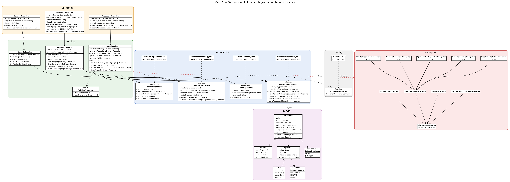
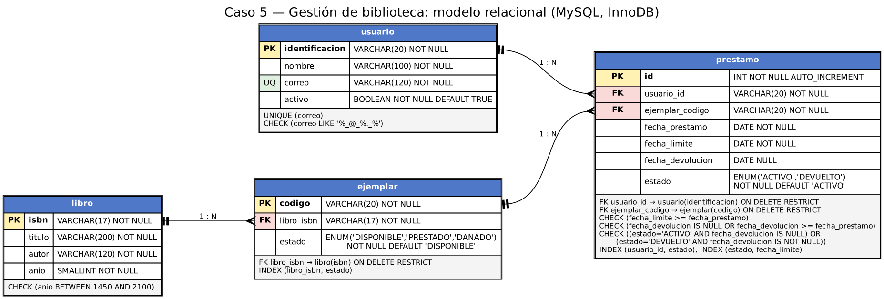

# Etapa 1 — Análisis, diseño y arquitectura

## 9.1 Identificación

- Caso asignado: Caso 5 - Gestión de Biblioteca
- Integrante 1: Maria Jimenez Alpizar — GitHub: MaFerJimenez-14
- Integrante 2: Mishia Valverde Narváez — GitHub: mishia-gvn
- URL del repositorio: <https://github.com/MaFerJimenez-14/examen1progra3-jimenez-valverde.git>

## 9.2 Descripción del problema

### Problema que se desea resolver:

La biblioteca comunitaria presta libros a usuarios registrados. Cada título del catálogo puede contar con varios ejemplares físicos, por lo que se necesita controlar cuáles están disponibles, quién tiene cada ejemplar prestado y cuáles préstamos presentan atrasos.

La falta de un control centralizado puede provocar que se intente prestar un ejemplar no disponible, que usuarios con préstamos atrasados soliciten otros libros o que no se identifique fácilmente a las personas responsables de las devoluciones pendientes.

El sistema permitirá registrar y consultar usuarios, libros, ejemplares y préstamos. Además, controlará las operaciones de préstamo y devolución y aplicará las reglas de negocio definidas para mantener la información consistente.

### Usuario del sistema

El sistema será utilizado por el bibliotecario o la bibliotecaria mediante una aplicación de consola. El personal bibliotecario registrará los datos de los lectores y gestionará sus préstamos; los lectores no interactuarán directamente con la aplicación.

### Principales operaciones:

- Registrar, consultar, listar y actualizar usuarios, incluida su desactivación.
- Registrar libros y sus ejemplares.
- Consultar libros, ejemplares y la cantidad de ejemplares disponibles.
- Cambiar el estado de un ejemplar cuando corresponda, por ejemplo, para marcarlo como dañado.
- Registrar préstamos de ejemplares disponibles, validando las reglas de negocio.
- Registrar devoluciones y calcular los días de atraso, si los hay.
- Consultar los préstamos activos de un usuario.
- Generar un reporte de préstamos atrasados.

## 9.3 Requerimientos funcionales

| ID | Requerimiento funcional |
|:-----------------------------------|:-----------------------------------|
| RF-01 | El sistema permitirá registrar usuarios con identificación, nombre y correo. Todo usuario nuevo quedará activo. |
| RF-02 | El sistema permitirá consultar un usuario por su identificación y listar todos los usuarios registrados. |
| RF-03 | El sistema permitirá actualizar el nombre, el correo y el estado de un usuario (activo o inactivo). |
| RF-04 | El sistema permitirá registrar libros con ISBN, título, autor y año, así como registrar ejemplares asociados a un libro existente. Todo ejemplar nuevo quedará en estado `DISPONIBLE`. |
| RF-05 | El sistema permitirá consultar un libro por su ISBN, listar los libros, listar los ejemplares de un libro y consultar cuántos ejemplares están disponibles. |
| RF-06 | El sistema permitirá cambiar el estado de un ejemplar a `DISPONIBLE` o `DANADO`. No permitirá cambiar manualmente el estado de un ejemplar `PRESTADO`. |
| RF-07 | El sistema permitirá prestar un ejemplar disponible a un usuario. La fecha límite será ocho días después de la fecha del préstamo y el registro del préstamo y el cambio de estado del ejemplar se realizarán en una misma transacción. |
| RF-08 | El sistema permitirá registrar la devolución de un préstamo activo, guardar la fecha de devolución, cambiar el préstamo a `DEVUELTO` y el ejemplar a `DISPONIBLE` dentro de una misma transacción. También informará los días de atraso, si los hay. |
| RF-09 | El sistema permitirá consultar los préstamos activos de un usuario, mostrando el título del libro, el código del ejemplar y la fecha límite. La consulta combinará la información de préstamos, ejemplares y libros mediante un `JOIN`. |
| RF-10 | El sistema permitirá generar un reporte de préstamos atrasados que muestre el nombre del usuario, el título del libro, la fecha límite y los días de atraso, combinando la información correspondiente mediante `JOIN`. |

## 9.4 Reglas de negocio

| ID | Regla | Operación donde se aplica | Qué ocurre si se viola |
|:-----------------|:-----------------|:-----------------|:------------------|
| RN-01 | No se puede prestar un ejemplar cuyo estado no sea `DISPONIBLE`. | Registrar préstamo (RF-07). | Se rechaza mediante `EjemplarNoDisponibleException`; no deben conservarse cambios parciales. |
| RN-02 | Un usuario con préstamos atrasados no puede solicitar nuevos préstamos. Se considera atrasado un préstamo `ACTIVO` cuya fecha límite ya pasó. | Registrar préstamo (RF-07). | Se rechaza mediante `UsuarioConAtrasoException`. |
| RN-03 | Un usuario no puede tener más de tres préstamos `ACTIVOS` al mismo tiempo. | Registrar préstamo (RF-07). | Se rechaza mediante `LimitePrestamosException`. |
| RN-04 | Solo se puede devolver un préstamo que esté en estado `ACTIVO`. | Registrar devolución (RF-08). | Se rechaza mediante `PrestamoNoActivoException`. |
| RN-05 | Un usuario inactivo no puede solicitar préstamos. | Registrar préstamo (RF-07). | Se rechaza mediante `UsuarioInactivoException`. |
| RN-06 | La fecha límite corresponde a la fecha del préstamo más ocho días. | Registrar préstamo (RF-07). | El sistema calcula la fecha mediante `PoliticaPrestamo`. |
| RN-07 | La identificación y el correo de un usuario deben ser únicos. También deben ser únicos el ISBN de un libro y el código de un ejemplar. | Registrar usuario, libro o ejemplar (RF-01 y RF-04). | Se rechaza el registro duplicado mediante la validación correspondiente. |
| RN-08 | Un ejemplar en estado `PRESTADO` solo puede volver a `DISPONIBLE` mediante el proceso de devolución. | Cambiar estado de ejemplar (RF-06). | Se rechaza el cambio manual mediante `ValidacionException`. |
| RN-09 | Los campos obligatorios no pueden estar vacíos, el correo debe tener un formato válido y el año del libro debe estar entre 1450 y 2100. | Registros y actualizaciones (RF-01, RF-03 y RF-04). | Se rechaza mediante `ValidacionException`. |

### Decisiones de análisis:

- **El atraso se calcula y no se almacena como estado.** `EstadoPrestamo` contiene únicamente `ACTIVO` y `DEVUELTO`. Un préstamo se considera atrasado cuando está `ACTIVO` y su fecha límite es anterior a la fecha actual. Esto evita mantener un estado adicional que tendría que actualizarse diariamente.
- **Las reglas RN-03 y RN-05 se validan al prestar.** Ambas determinan si un préstamo nuevo puede realizarse.
- **Los usuarios se desactivan en lugar de eliminarse.** Se conserva `activo = false` para mantener el historial de préstamos y evitar problemas con las llaves foráneas.
- **Orden de validación del préstamo.** Se comprueba que el usuario exista y esté activo, que no tenga atrasos y que no haya alcanzado el límite de préstamos. Después se verifica que el ejemplar exista y esté disponible.
- **Las operaciones de préstamo y devolución deben ser atómicas.** Si una modificación falla, se revierten los cambios de la transacción para evitar que el préstamo y el estado del ejemplar queden inconsistentes.

## 9.5 Entidades, atributos y relaciones

### Entidades

| Clase | Responsabilidad | Atributos principales |
|:-----------------------|:-----------------------|:-----------------------|
| `Usuario` | Representa a un lector registrado e indica si puede solicitar préstamos. | `identificacion`, `nombre`, `correo`, `activo` |
| `Libro` | Representa un título del catálogo, independientemente de la cantidad de copias físicas. | `isbn`, `titulo`, `autor`, `anio` |
| `Ejemplar` | Representa una copia física de un libro y su estado actual. | `codigo`, `libro`, `estado` |
| `Prestamo` | Registra el préstamo de un ejemplar a un usuario y su ciclo de vida. Permite determinar si está atrasado y calcular los días de atraso. | `id`, `usuario`, `ejemplar`, `fechaPrestamo`, `fechaLimite`, `fechaDevolucion`, `estado` |

### Relaciones

| Clases relacionadas | Tipo de relación | Multiplicidad | Explicación |
|:-----------------|:-----------------|:-----------------|:-----------------|
| `Libro` --- `Ejemplar` | Asociación | Un `Libro` con `0..*` `Ejemplar`; cada `Ejemplar` corresponde a `1` `Libro`. | Un título puede tener varios ejemplares físicos. |
| `Usuario` --- `Prestamo` | Asociación | Un `Usuario` con `0..*` `Prestamo`; cada `Prestamo` corresponde a `1` `Usuario`. | Un usuario puede tener un historial de préstamos y hasta tres préstamos activos simultáneamente. |
| `Ejemplar` --- `Prestamo` | Asociación | Un `Ejemplar` con `0..*` `Prestamo` a lo largo del tiempo; cada `Prestamo` corresponde a `1` `Ejemplar`. | Un ejemplar puede prestarse varias veces, pero no debe tener más de un préstamo activo simultáneamente. |
| `Ejemplar` --- `EstadoEjemplar` | Atributo de tipo enumerado | Cada `Ejemplar` tiene un estado. | El estado puede ser `DISPONIBLE`, `PRESTADO` o `DANADO`. |
| `Prestamo` --- `EstadoPrestamo` | Atributo de tipo enumerado | Cada `Prestamo` tiene un estado. | El estado puede ser `ACTIVO` o `DEVUELTO`. |

La clase `Prestamo` registra la operación entre `Usuario` y `Ejemplar`.

### Enumeraciones:

``` java
public enum EstadoEjemplar {
    DISPONIBLE,
    PRESTADO,
    DANADO
}

public enum EstadoPrestamo {
    ACTIVO,
    DEVUELTO
}
```

## 9.6 Diagrama de clases UML

El diagrama de clases representa las clases del sistema, sus atributos y operaciones principales, las relaciones entre ellas y las dependencias entre las capas de la arquitectura.

- **Imagen:** `docs/etapa_1/diagramas/uml.png`
- **Fuente Graphviz:** `docs/etapa_1/diagramas/uml.dot`



## 9.7 Modelo relacional

El modelo relacional representa las tablas, sus claves primarias y foráneas y las restricciones necesarias para mantener la integridad de los datos.

- **Imagen:** `docs/etapa_1/diagramas/modelo_relacional.png`

- **Fuente Graphviz:** `docs/etapa_1/diagramas/modelo_relacional.dot`

  

- **Script SQL preliminar:** [`database/schema.sql`](../../database/schema.sql)

## Restricciones principales:

- **Claves primarias (PK):** `usuario.identificacion`, `libro.isbn`, `ejemplar.codigo` y `prestamo.id` (`AUTO_INCREMENT`).
- **Claves foráneas (FK):** `ejemplar.libro_isbn` referencia `libro`; `prestamo.usuario_id` referencia `usuario`; y `prestamo.ejemplar_codigo` referencia `ejemplar`.
- **Integridad referencial:** las relaciones deben proteger el historial de préstamos y evitar eliminar registros referenciados.
- **Unicidad:** el correo del usuario debe ser único; la identificación, el ISBN y el código del ejemplar también deben ser únicos mediante sus claves primarias.
- **Validación de datos:** se contemplan restricciones para el año del libro, las fechas del préstamo y la coherencia entre el estado del préstamo y su fecha de devolución.
- **Estados:** los valores de los estados en la base de datos deben coincidir con las enumeraciones de Java.
- **Índices:** se consideran índices para consultas frecuentes, como la disponibilidad de ejemplares, los préstamos activos por usuario y los préstamos atrasados.

## 9.8 Arquitectura propuesta

El paquete base del proyecto es `cr.ac.una`. La aplicación separa las responsabilidades en capas: `app` presenta el menú de consola, `controller` coordina las solicitudes, `service` aplica las validaciones y reglas de negocio, y `repository` define el acceso a los datos. `model` representa las entidades y enumeraciones; `config` proporciona conexiones y `exception` define los errores de la aplicación.

| Capa | Clases | Responsabilidad |
|:---------------------|:---------------------------|:---------------------|
| `app` | `App`, `Consola` | Mostrar el menú, capturar entradas y presentar resultados. No accede directamente a repositorios ni ejecuta SQL. |
| `model` | `Usuario`, `Libro`, `Ejemplar`, `Prestamo`, `EstadoEjemplar`, `EstadoPrestamo` | Representar los datos del dominio. No utiliza JDBC ni lee datos de la consola. |
| `repository` | Interfaces `UsuarioRepository`, `LibroRepository`, `EjemplarRepository`, `PrestamoRepository` | Definir las operaciones de persistencia. En la Etapa 2 se implementarán las clases JDBC que ejecutarán las consultas SQL y convertirán los resultados de la base de datos en objetos del modelo. Esta capa no contiene reglas de negocio. |
| `service` | `UsuarioService`, `CatalogoService`, `PrestamoService`, `PoliticaPrestamo` | Validar datos y aplicar reglas de negocio. `PrestamoService` coordina las transacciones de préstamo y devolución. |
| `controller` | `UsuarioController`, `CatalogoController`, `PrestamoController` | Recibir solicitudes, invocar los servicios y preparar respuestas o mensajes para el bibliotecario. No contiene SQL ni decide las reglas de negocio. |
| `config` | `ConexionBD`, `ProveedorConexion` | Proporcionar conexiones a la base de datos mediante la configuración local. Los servicios dependen de `ProveedorConexion` cuando necesitan una conexión. |
| `exception` | `BibliotecaException`, `ValidacionException`, `EntidadNoEncontradaException`, `DatosException`, `ReglaNegocioException` y sus subclases | Representar errores de validación, reglas de negocio, entidades no encontradas y acceso a datos. |

### Decisiones de diseño:

- **Programación contra interfaces.** Los servicios reciben las interfaces de los repositorios mediante el constructor. Así, la lógica de negocio no depende directamente de una implementación concreta de JDBC.
- **Transacciones en la capa `service`.** Las operaciones de préstamo y devolución modifican más de una tabla. El servicio coordina la transacción y confirma los cambios solo cuando todas las operaciones concluyen correctamente; de lo contrario, ejecuta `rollback`.
- **Conexión compartida durante una transacción.** Los métodos de repositorio que participan en una transacción reciben la misma `Connection` y no deben confirmar ni cerrar esa conexión por su cuenta.
- **Control de concurrencia.** El cambio de estado del ejemplar debe verificar que siga disponible al actualizarlo. Si otro préstamo modifica el estado primero, la operación debe rechazarse y revertirse.
- **Política de préstamo centralizada.** La duración de ocho días y el máximo de tres préstamos activos se definen en `PoliticaPrestamo`.
- **Fecha controlable para las pruebas.** `PrestamoService` puede recibir un `Clock` para permitir pruebas con fechas controladas y verificar los atrasos sin depender de la fecha real de ejecución.
- **Repositorios separados.** `LibroRepository` y `EjemplarRepository` se mantienen separados porque representan conceptos distintos y tienen operaciones diferentes.

### Interfaces Repository/DAO definidas:

La siguiente interfaz ilustra las operaciones previstas para los préstamos.

``` java
package cr.ac.una.repository;

import cr.ac.una.model.Prestamo;

import java.sql.Connection;
import java.time.LocalDate;
import java.util.List;
import java.util.Optional;

public interface PrestamoRepository {

    int insertar(Connection conexion, Prestamo prestamo);

    Optional<Prestamo> buscarPorId(int id);

    void registrarDevolucion(Connection conexion, int id, LocalDate fechaDevolucion);

    List<Prestamo> listarActivosPorUsuario(String identificacionUsuario);

    List<Prestamo> listarAtrasados(LocalDate hoy);

    int contarActivosPorUsuario(String identificacionUsuario);

    boolean tieneAtrasados(String identificacionUsuario, LocalDate hoy);
}
```

## Código de la Etapa 1

Marca cada punto como completado únicamente después de verificarlo en el proyecto.

- [x] Clases del modelo con atributos privados, constructores, getters/setters y `toString()`.
- [x] Enumeraciones.
- [x] Interfaces `Repository`/`DAO`.
- [x] Estructura de `Service` y `Controller`.
- [x] Excepciones personalizadas.
- [x] Proyecto compilado correctamente con Maven.

## Distribución del trabajo

| Integrante | Aportes principales |
|------------------------------------|------------------------------------|
| Maria Jimenez Alpizar | Creación y configuración del repositorio GitHub, elaboración de `database/schema.sql`, diseño del modelo relacional, desarrollo del paquete `model` (entidades y enumeraciones) y definición de las interfaces del paquete `repository`. |
| Mishia Valverde Narváez | Desarrollo del paquete `exception`, configuración de `config/ProveedorConexion`, desarrollo de los paquetes `service` y `controller`, elaboración del diagrama UML y documentación de la Etapa 1 en `docs/etapa_1/entrega.md`. |
