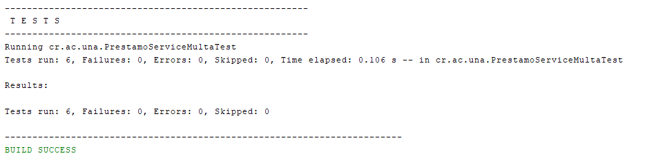
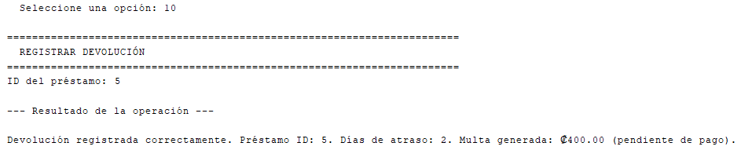
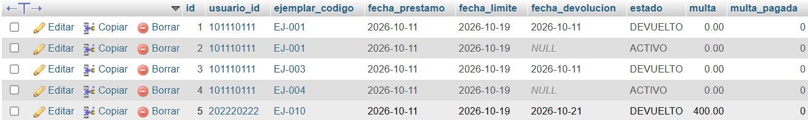
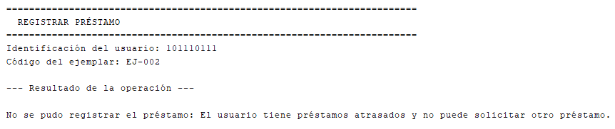

# Pruebas documentadas

> Mínimo diez pruebas: al menos cuatro exitosas, cuatro de error y la operación de negocio principal en ambos sentidos (éxito y rechazo).

## Tipo de pruebas

- [x] Manuales con evidencia (aplicación de consola sobre MySQL 8.0.32)
- [x] Automatizadas con JUnit 5 (`mvn test`) — clases: `PrestamoServiceMultaTest`, `EjemploPruebaTest`

Las pruebas automatizadas de `PrestamoServiceMultaTest` prueban `PrestamoService` sin base de datos: usan implementaciones en memoria de las interfaces `PrestamoRepository`, `EjemplarRepository` y `UsuarioRepository`, y un `Clock` fijo para simular la fecha de devolución.

## Casos de prueba

| ID | Tipo (éxito / error) | Descripción | Datos de entrada | Resultado esperado | Resultado obtenido | Estado |
|---|---|---|---|---|---|---|
| P-01 | Éxito | Devolver a tiempo no genera multa (RN-N1) | Préstamo con fecha límite 10/10/2026, devuelto el 10/10/2026 | Multa ₡0, sin multa pendiente | Multa ₡0 guardada | ✅ |
| P-02 | Éxito | Un día de atraso genera ₡200 (RN-N1) | Devuelto el 11/10/2026 | Multa ₡200, pendiente de pago | Multa ₡200, pendiente | ✅ |
| P-03 | Éxito | Cinco días de atraso: la multa se calcula y se guarda en el préstamo (RN-N1) | Devuelto el 15/10/2026 | Multa ₡1000 guardada, `multaPagada = false`, préstamo DEVUELTO, ejemplar DISPONIBLE | Coincide | ✅ |
| P-04 | Éxito | Cálculo de la política de multas | 0, −3 y 7 días de atraso | ₡0, ₡0 y ₡1400 | Coincide | ✅ |
| P-05 | Error | Devolver dos veces el mismo préstamo no recalcula la multa (RN-04) | Devolución con 2 días de atraso y luego un segundo intento | Segundo intento rechazado con `PrestamoNoActivoException`; la multa sigue en ₡400 | Rechazado; multa ₡400 | ✅ |
| P-06 | Éxito | Una multa pagada no queda pendiente | Multa ₡600, `multaPagada = true` | `tieneMultaPendiente()` = false | false | ✅ |
| P-07 | Éxito (manual, MySQL) | La multa se calcula y se guarda en la base de datos (RN-N1) | Opción 10, préstamo ID 5 (fecha límite 19/10/2026), devuelto el 21/10/2026 | Mensaje con 2 días de atraso y multa de ₡400; en `prestamo`: `multa = 400.00`, `multa_pagada = 0`, estado DEVUELTO | "Días de atraso: 2. Multa generada: ₡400.00 (pendiente de pago)"; fila 5 con `multa = 400.00`, `multa_pagada = 0`, DEVUELTO | ✅ |
| P-08 | Error (manual, MySQL) | Usuario con préstamo atrasado no puede pedir otro (RN-02) — operación de negocio rechazada | Opción 9, usuario `202220222`, ejemplar `EJ-010` | Rechazo: "El usuario tiene préstamos atrasados..." | "No se pudo registrar el préstamo: El usuario tiene préstamos atrasados y no puede solicitar otro préstamo." | ✅ |
| P-09 | | | | | | |
| P-10 | | | | | | |

> P-01 a P-06: `PrestamoServiceMultaTest` (JUnit). P-07 y P-08: manuales sobre MySQL.
> P-09 en adelante: bloqueo por multa pendiente (RN-N2), pago de multa (RN-N3) y consulta de usuarios con deudas.

## Evidencias

### Pruebas automatizadas (JUnit 5) — P-01 a P-06

### P-07: multa calculada y guardada en MySQL

Devolución del préstamo 5 con 2 días de atraso:

Registro en la tabla `prestamo` después de la devolución:

### P-08: rechazo por préstamos atrasados (RN-02)

## Resumen

| Total | Exitosas | Fallidas |
|---:|---:|---:|
| 8 | 8 | 0 |

> Actualizar al agregar las pruebas P-09 en adelante.